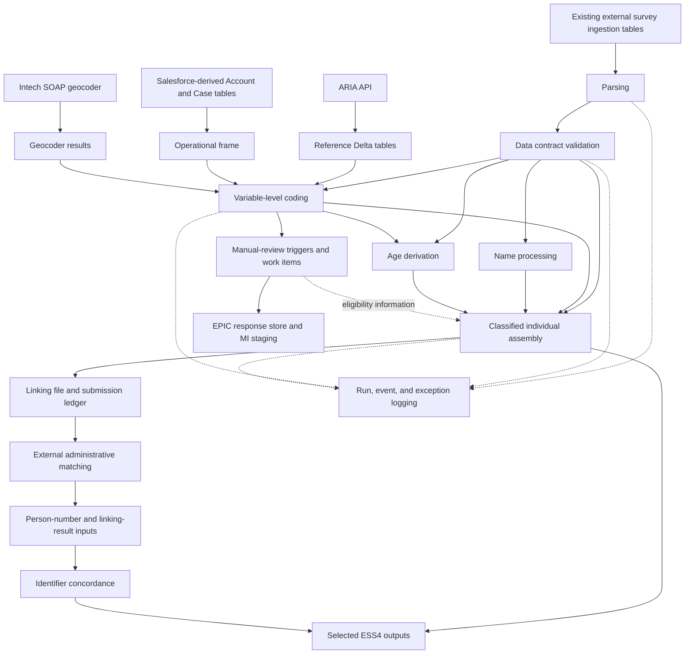

# Project Guide: SPH Survey Data Sourcing

## How To Use This Guide

Start with sections 1-4 for the overall picture, sections 5-12 for how processing works, and sections 13-18 for development and the file map.

This is a static explanation of the repository as inspected on 2026-10-15. The visible workspace inventory contained 394 files before this guide was added. The analysis inventories the repository and follows its principal implementation, configuration, notebook, deployment, and test paths. Repetitive configuration and test files are grouped by purpose below; this is not a claim that every line or every reference-data value has been individually audited. Screenshots are documentation assets, not executable components. No Databricks jobs, external APIs, deployments, or tests were run for this analysis.

Descriptions of design intent are distinguished from observed implementation gaps. Having a module, configuration file, or test specification does not prove a feature is complete or deployed.

## 1. What This Project Does

This is a Python/PySpark data-processing project for social census survey responses, run primarily on Azure Databricks.

Its central job is to turn raw questionnaire responses into structured, validated, classified, enriched, and selectively de-identified datasets. It also prepares files for an external administrative-data linking system and prepares difficult cases for human review.

It is not a website, a transactional application, or one continuously running Python service. Most production entry points are Databricks notebooks invoked by independent job definitions.

The main implemented collection is `social_census`. A second collection, `config_test_survey`, supplies configuration fixtures and examples for testing shared infrastructure.

### Vocabulary

| Term | Meaning here |
| --- | --- |
| Collection | A survey namespace with its own configuration, such as `social_census`. |
| Collection instance | The particular survey operation/sub-operation associated with a response. It is part of record identity. |
| Individual | A person-level response. |
| Dwelling | A response about a residence/building. |
| Household | A household-level response, including information about people living there. |
| Dwelling-person | A person entry expanded out of a household response. One household can produce multiple such rows. |
| Steady state | A named, persisted processing stage. It is a table/schema boundary, not a Python process state. |
| Classification | A standard set of statistical codes and descriptions. |
| Coding | Converting an answer into a classification code. This is not software programming. |
| Residual | A meaningful code for cases such as not stated, refused, out of scope, or unidentifiable. |
| Paradata | Metadata describing an output's source or how it was coded. |
| Operational frame | Reference records describing relevant units/addresses, assembled from Salesforce-derived tables. |
| Concordance | A mapping between code systems or identifiers. The ARIA concordance and person-ID concordance are different mappings. |
| Delta table | A Databricks/Spark table format supporting transactional updates and merges. |
| Unity Catalog | Databricks' namespace and governance system. Tables are addressed as `catalog.schema.table`. |
| Watermark | A timestamp boundary used to select data for incremental processing. |
| SCD Type 2 | Keeping an old record version when its data changes, then inserting a new current version. |
| MI | Manual intervention: preparing a case for human review. |
| ARIA | The classification/reference API consumed by this project. |
| ADPS | The external administrative linking system referred to by the export job. Its matching engine is not implemented here. |

## 2. Overall Architecture



The diagram describes data dependencies, not one centrally enforced job dependency graph. Several jobs run independently on schedules. The return-and-apply path for completed human fixes is not implemented end to end.

### Layers And Responsibilities

| Layer | Location | Responsibility |
| --- | --- | --- |
| Infrastructure/orchestration | `dab/`, `.azuredevops/`, [databricks.yml](databricks.yml) | Deploy resources, select compute, schedule jobs, and start notebooks. |
| Entry points | `src/notebooks/` | Read runtime parameters, instantiate an operation, run it, and arrange logging. |
| Processing framework | `src/transformations/` | Read inputs, execute business rules, and write outputs. |
| Reusable domain logic | `src/coding/`, `src/names_processing/` | Text/numeric coding, matching, and name normalization. |
| External integration | `src/services/`, `src/manual_intervention/` | Reference extraction, geocoding, operational-frame construction, and EPIC communication. |
| Configuration and contracts | `configuration/`, `src/config_models/` | Resolve datasets and environments, validate configuration, and describe rules and table shapes. |
| Persistence provisioning | `src/database/` | Create schemas, volumes, and tables; hold explicit migration scripts. |
| Shared support | `src/utils/` | Incremental filtering, logs, retries, file helpers, diagnostics, and searches. |
| Verification | `tests/` | Unit-level checks, business scenarios, fixtures, and an integration-test runner. |

## 3. Repository Structure

```text
repository/
  pyproject.toml              Python packaging, dependencies, and tooling
  databricks.yml             Databricks Asset Bundle root
  configuration/
    collections/
      social_census/         Collection inventory, transformations, contracts, MI
      config_test_survey/    Configuration fixtures for tests/examples
    deployment/
      social_census/         Physical table definitions
    aria_config.yml          ARIA extraction settings
    operational_frame.yml   Operational-frame inputs and output fields
    geocoder_variables.yml  Geocoder settings, addresses, and output mapping
  src/
    definitions.py           Paths, environment loading, Spark, and dbutils
    notebooks/               Databricks execution entry points
    transformations/         Shared framework plus survey-specific operations
    coding/                  Reusable classification machinery
    names_processing/        Shared name-cleaning rules
    config_models/           Configuration objects and Pydantic schemas
    services/                API and reference-data integrations
    manual_intervention/     Human-review lifecycle and EPIC integration
    database/                Object provisioning and explicit migrations
    utils/                   Cross-cutting helpers and structured logs
  classifications/           Small checked-in lookup/reference assets
  dab/
    resources/jobs/          Databricks job definitions
    resources/clusters/      Shared classic compute definitions
    resources/libraries/     Job dependency lists
    targets/                 Local, dev, tst1, and uat1 bundle settings
  .azuredevops/               CI/CD pipelines and templates
  tests/
    unit/                    Module-focused tests
    bdd/features/            Business rules expressed as scenarios
    bdd/steps/               Scenario implementation and fixtures
    integration/             Databricks pytest runner and placeholder checks
    test_data/               CSV inputs/reference fixtures
    utils/                   Shared test helpers
  demo/                      Explorations and runnable examples
  _readme_artifacts/          Setup screenshots
```

This is a layered, configuration-driven data application. It is not primarily a web-style MVC architecture or a collection of independently deployed microservices.

## 4. Persisted Stages And Table Naming

The authoritative inventory is [the collection configuration](configuration/collections/social_census/config.yml). It maps a logical dataset and steady state to an environment-specific physical table.

For example, `individual` in `validated`, for `dev`, resolves to:

```text
socpophousdata1_dev.social_census_validated.individual
```

| Configured state | Main contents | Role |
| --- | --- | --- |
| `ess1` | `census_if`, `census_df`, `census_hsf` | Existing external ingestion inputs. |
| `parsing` | `individual`, `dwelling`, `household`, `dwelling_person` | Flattened and typed questionnaire data. |
| `validated` | The same four datasets | Records passing implemented contract checks. |
| `reference_data` | ARIA classification/synonym/concordance, operational frame, geocoder results | Supporting reference data. |
| `aria_classify` | Per-variable tables such as ethnicity, gender, DOB, usual residence | Standardized codes and coding metadata. |
| `names_processed` | Individual and household names | Names prepared for linking. |
| `pre_imputation_derivations` | Age | Derived response/reference-date ages. No full imputation engine is established here. |
| `classified` | Primarily assembled individual data; dwelling/other datasets are also declared | Combined coded outputs. Declarations do not establish every builder exists. |
| `manual_intervention` | Work items and status history | Human-review queue and audit journal. |
| `admin_linking` | Concordance, records submitted, file-related datasets, linking volume | External linking exchange and tracking. |
| `people_cas_standardised` | Person numbers | Inputs used to build identifier concordance. |
| `people_linked_cas` | Linking results | Matching results used to build identifier concordance. |
| `de_identified` | Individual and dwelling implementations; household is also declared | Selected downstream output shapes. |
| `logs` | Pipeline runs, events, exceptions | Operational observability. |

Important naming warning: comments call parsing `ESS0 -> ESS1`, while the collection's source state is named `ess1` and uses an `ess1` ingestion schema. Job names use ESS1/ESS2/ESS3/ESS4; internal states are more descriptive. Follow resolved dataset paths and code, not the number alone. This resembles staged/medallion processing, but the repository does not simply define bronze/silver/gold layers.

The configured processing catalog is `socpophousdata1_<environment>`. The external survey ingestion catalog is `social_census_<environment>`. Supported collection environments are `dev`, `tst1`, and `uat1`.

## 5. Step One: Ingestion Boundary And Parsing

### What Arrives

The project reads already-landed survey response tables. The contracts describe Forsta-origin payloads, and responses contain identifiers, metadata, submission timestamps, and a JSON `data` field. The original collection system and raw-file landing mechanism are outside the principal implementation here.

The three input forms are individual (`census_if`), dwelling (`census_df`), and household (`census_hsf`).

### Concrete Individual Example

An illustrative raw input contains:

```json
{
  "responseId": "example-person-id",
  "caseId": "example-case-id",
  "collectionInstance": "example-operation",
  "data": "{\"IF_age_calculated\":\"35\",\"IF_date_of_birth\":{\"day\":\"12\",\"month\":\"4\",\"year\":\"1991\"}}"
}
```

This is explanatory input, not a complete contract-valid fixture. The parser maps `responseId` to `person_nbr`, `caseId` to `sf_case_id`, and `collectionInstance` to `collection_instance`. It extracts age and DOB components into typed columns rather than leaving every value buried in JSON.

### Call Path

1. [The parsing job](dab/resources/jobs/cas_ess1_tableupdate_individual.job.yml) invokes [the individual parsing notebook](src/notebooks/individual_form_parsing.py).
2. The notebook delegates to `run_parsing_job()` in [parsing_orchestrator.py](src/transformations/parsing_orchestrator.py).
3. `Parsing` loads [the individual mapping](configuration/collections/social_census/individual/individual_parsing.yml) through the shared configuration framework.
4. The orchestrator checks that the output table already exists.
5. The shared reader selects current input rows and applies a watermark or explicit reprocessing filters.
6. [parsing.py](src/transformations/parsing.py) parses JSON, expands configured loops, builds configured columns, and returns separate success and failure DataFrames.
7. Failures are logged using record identifiers and technical reasons, without logging raw observed response values in the standard parsing failure path.
8. A coverage check verifies that source identities appear in either success or failure output.
9. Blocking target-column/type mismatches are logged and stop the operation. Parsing deliberately ignores nullability mismatches.
10. Successfully parsed rows go to the shared history-preserving writer.

The household notebook runs two mappings: household output and dwelling-person expansion. Dwelling-person deliberately skips the usual no-silent-loss assertion because an empty people loop can validly produce zero rows.

### Mapping Expressions

| YAML expression | Meaning |
| --- | --- |
| `responseId` | Read a source column directly. |
| `data:IF_age_calculated` | Extract a top-level field from JSON. |
| `data:IF_date_of_birth:day` | Extract a nested JSON value. |
| `explode:...` | Expand array elements into separate rows. |
| `posexplode:...` | Expand array elements while retaining position. |
| `ordered_map_values:...` | Turn numerically keyed JSON object values into an ordered array. |

Supported parsing casts include strings, integers of several widths, timestamps, and arrays of strings. Safe casts trim input, handle blanks, remove commas, and use `try_cast` so malformed numeric input can be recorded as a failure instead of crashing the entire Spark expression.

Observed failure classes include missing primary keys, malformed JSON, invalid loop-array JSON, and failed typed casts. A failed input identity is excluded from successful output.

## 6. Step Two: Data Contract Validation

Entry point: [validate_data_contract.py](src/notebooks/validate_data_contract.py). Engine: [data_contracts_validation.py](src/utils/data_contracts_validation.py). Example: [the individual contract](configuration/collections/social_census/data_contracts/individual_ess1.yml).

The contracts are shaped like ODCS v3.1.0 documents. However, the runtime engine is custom Spark code; it should not be described as a complete implementation of the standard.

1. Resolve the contract, source table, and validated target table.
2. Read a watermarked subset of parsed records.
3. Build violation DataFrames from implemented rules.
4. Extract identifiers, field names, expected constraints, and rule names for exception logging.
5. Deduplicate equivalent violations.
6. Exclude failing records with a null-safe anti-join on contract primary keys.
7. Write passing rows to the validated table and record final run status.

Implemented checks include required/non-null fields, minimum/maximum values, string lengths, regex patterns, enumerations, and array shape/element-type checks.

For example, age `150` can parse as an integer successfully but then fail the contract's `0..120` range. This illustrates why parsing and validation are different stages.

Limitations visible in the current engine:

- Not every contract keyword is enforced. Array `minItems`/`maxItems` and nested item-length declarations are not implemented in the shown rule loop.
- General scalar-type/schema validation is not a complete standalone gate in this engine.
- `extract_schema_violations_df()` currently returns an empty DataFrame; the notebook contains a schema-failure branch, but that function does not currently populate it.
- The individual contract lists `dev` and `tst1` servers, while collection configuration also supports `uat1`; check contract environment coverage before a UAT run.
- Primary-key declarations are used to identify failed records; they are not, by themselves, evidence of a full uniqueness-validation implementation.

Invalid rows are recorded as exceptions and omitted from the validated output. This is not the same thing as a complete quarantine store containing every original rejected payload. [failure_lookup.py](src/utils/failure_lookup.py) supports retrieving original source rows by logged identifiers when authorized.

## 7. Step Three: Reference Data And Address Services

### ARIA Extraction

[aria_access.py](src/notebooks/aria_access.py) invokes [aria_api.py](src/services/aria_api.py) using [aria_config.yml](configuration/aria_config.yml).

The extractor gets its API key through Databricks secrets, fetches classifications/synonyms/concordances, flattens hierarchical codes, and writes the resulting reference datasets with the shared writer. It retains details such as hierarchy depth, parent code, materialized path, and leaf status. Supplied additional IDs can be persisted to the configuration after successful fetches.

Shared retry machinery handles selected transient HTTP failures. Note that the current ARIA request explicitly disables certificate verification; this is a deployment/security consideration, not a recommendation to copy the pattern.

### Operational Frame

[populate_operational_frame.py](src/notebooks/populate_operational_frame.py) calls [operational_frame_service.py](src/services/operational_frame_service.py), configured by [operational_frame.yml](configuration/operational_frame.yml).

This service reads Salesforce-derived Account and Case tables already present in Spark. It is not a direct Salesforce HTTP client. It filters by collection instance and permitted address types, derives an address key, and outputs unit identifiers, coordinates, meshblock, address details, and a multiple-dwelling indicator.

On incremental runs, changes in either Account or Case identify affected address groups. The service rereads all members of those groups before recomputing the multiple-dwelling indicator. Otherwise, processing only the changed row could incorrectly label a shared address as a single dwelling.

### Geocoding

[geocode_addresses.py](src/notebooks/geocode_addresses.py) calls [geocoder.py](src/services/geocoder.py) using [geocoder_variables.yml](configuration/geocoder_variables.yml).

It builds a SOAP request for configured addresses, posts it to Intech, parses returned XML, interprets matching flags/reliability, renames/selects fields, and appends results to Delta. This service's save method is an append path, not the general SCD2 writer.

The current geocoding notebook operates on addresses supplied in its configuration. Do not assume it automatically extracts every outstanding respondent address from the survey tables.

## 8. Step Four: Coding And Transformation

### Shared Transformation Lifecycle

[AbstractTransformation](src/transformations/abstract_transformation.py#L18) provides the normal lifecycle:

```text
construct -> resolve configuration -> read() -> transform() -> write()
                                                run() wraps the task in logging
```

Each `read()` normally returns a dictionary of DataFrames keyed by the configured dataset key, such as `responses`. The subclass's `transform()` decides how to join those inputs and apply business rules. The default writer projects configured output fields and writes each configured output dataset.

Parsing uses its own orchestrator because it produces both successes and failures. Administrative export overrides writing because it must produce a physical file and a submission ledger, not just one result table.

### Generic Text Coding

The text-coding framework uses reference data plus progressively more permissive matching rules. It is rule-based/reference-driven processing, not a trained machine-learning classifier or an LLM integration.

For a single response, the implemented chain is broadly:

1. Normalize text: uppercase, normalize accented characters, remove configured buffer words and unsuitable punctuation/whitespace.
2. Assign the configured not-stated code for blank values.
3. Try exact raw synonym matching.
4. Try exact cleaned synonym matching.
5. Try the supplementary checked-in lookup table.
6. Reject very short unmatched values to a residual.
7. Try an alphabetic character match, which can tolerate changed character order.
8. Try Jaro-Winkler fuzzy matching with a configured threshold.
9. Try a longest partial-span match.
10. Assign an unidentifiable residual to anything still unmatched.

This order matters: later rules work on rows not already completed. A broad fuzzy rule does not get to overwrite a successful earlier exact match.

Multi-response coding also expands arrays, matches multiple phrases/spans, preserves input order when regrouping, and retains unmatched remainder text. Its exact rule sequence differs from the single-response sequence.

Results contain a code, matched synonym, and event/rule information, either as a struct or array of structs. These details help explain why a value received its code.

### Variable-Specific Operations

| Operation | Implemented responsibility |
| --- | --- |
| Ethnicity | Code predefined and free-text answers separately, merge distinct codes, prioritize/remove residuals, and add data-source paradata. |
| Gender | Code predefined and text answers, then use variable-specific decision rules to derive the final gender code. |
| Sex at birth / Maori descent | Apply their variable-specific coding and paradata rules. |
| Date of birth | Numerically code day/month/year components with configured ranges, widths, and residuals. |
| Usual residence | Use confirmed operational-frame address data or configured geocoder results, returning geography and coding events. |
| Dwelling description | Combine predefined and text classification results with variable-specific rules. |
| Dwelling joined / number of storeys | Code predefined answers through classification descriptors. |
| Number of rooms | Numeric coding for room-related inputs. Check configuration/wiring before treating it as a complete deployed workflow. |
| Age | Derive response-date and reference-date age codes from individual and coded-DOB inputs. |

Numeric coding maps blanks to not stated, non-integers to unidentifiable, and out-of-range numbers to out of scope. Valid values become zero-padded strings of the configured width. Residual codes are variable-specific; do not reuse one variable's residual meanings blindly for another.

The shared paradata helper uses `20100` for census-response information and `99999` for no information according to its configured not-stated comparison.

### Age Derivation Detail

[age.py](src/transformations/individual/derive/age.py) checks matching ordered primary keys and uniqueness of current source rows. It rebuilds affected people if either input changes.

Response-date age is numerically coded from `age_calculated`. Reference-date age is calculated from coded DOB. The reference date is June 30 in the submission year when submission is before June 30, and June 30 in the following year otherwise. Invalid DOB dates and the unknown-year residual are handled separately. This is more specific than simply subtracting birth year from today's year.

## 9. Step Five: Name Processing And Classified Assembly

### Name Processing

[IndividualNames](src/transformations/names_processing/individual_names.py#L15) chooses household-supplied names when the individual confirms them; otherwise it uses the individual's entered names. [HouseholdNames](src/transformations/names_processing/household_names.py#L15) prepares household name fields for the same shared normalizer.

[NameNormaliser](src/names_processing/name_normaliser.py#L39) builds native Spark expressions to clean accents/ligatures, remove leading titles and bracketed text, normalize surname prefixes, and derive first name, full first names, and last name. A small checked-in first-name lookup supports conservative splitting of concatenated names.

These operations prepare identifiers for linkage. They do not perform the external person-matching algorithm themselves. Normalizing names is also not de-identification.

### Classified Individual Assembly

The active job notebook imports [IndividualClassified](src/transformations/individual/individual_classified.py#L10), configured by [individual_classified.yml](configuration/collections/social_census/individual/individual_classified.yml).

It identifies keys changed in any incremental source, retrieves current records for those affected keys, checks MI eligibility, and left-joins the variable-level outputs onto the validated individual base. Inputs include processed names, gender, ethnicity, DOB, age, sex at birth, Maori descent, and usual residence.

For configured unresolved address residuals, a person is deferred unless the MI work item indicates the result was applied. This is an eligibility gate; this module does not implement importing and applying human fixes.

An older/simpler [classified.py](src/transformations/individual/classified.py) implementation also exists. It is not the class imported by the active ESS3 individual notebook. Do not confuse the two when looking for current assembly logic.

## 10. Step Six: Manual Intervention

The implemented address-review path works as follows:

1. Read recent current coded results and responses.
2. Select usual-residence cases with unidentifiable meshblock and useful address text.
3. Create work items containing identity, variable, trigger-rule version, and relevant JSON.
4. Remove duplicates against existing active work items.
5. Append status-history events and persist the current work-item state.
6. Upload new response data to EPIC's response store in batches.
7. Upload the complete set of uploadable work items to MI staging.
8. Ask EPIC to load the staged set and record status changes.

The lifecycle includes `NEW -> SENT -> STAGED`. The status model defines additional outcomes, but completing the entire lifecycle is not established by those enums alone.

The complete set is resent because the MI staging load replaces the set. Only newly required response payloads are exported to the response store. The MI work-item GUID is used as the EPIC response identifier so multiple review tasks can be distinguished.

Critical boundary: [MISyncService.import_fixed_work_items()](src/manual_intervention/mi_sync_service.py#L151) raises `NotImplementedError`. Do not assume reviewer fixes currently flow back into classified tables automatically.

## 11. Step Seven: Administrative Linking And ESS4

### Export For External Linking

[AdminLinking](src/transformations/individual/admin_linking.py#L14) joins classified individuals to validated details, selects eligible records using submission history, flattens arrays, applies export aliases, and creates a delimited file in a configured Unity Catalog volume.

The export uses `coalesce(1)` because the downstream interface expects one file. The code moves/renames Spark's generated part file into the required timestamped filename, then updates the `records_submitted` table. The single-file requirement simplifies exchange but concentrates output work and can become a scalability constraint.

Actual matching happens outside this repository. [IdConcordance](src/transformations/admin_linking/id_concordance.py#L8) subsequently joins person-number data and current external linking results on `snz_cas_uid`, keeping identifiers, match probability, collection instance, and source timestamps.

### ESS4 Individual

[IndividualDeIdentified](src/transformations/individual/individual_de_identified.py#L9) rebuilds records affected by changes in either classified individuals or the identifier concordance. It checks uniqueness and inner-joins classified `pk_hash` to concordance `id`, adding `snz_uid` and selecting the configured output fields.

The inner join means an individual without a matching concordance does not enter that output on that run. Names are not included in the configured output shape, but other fields such as response/case identifiers, DOB codes, and geography remain. The label `de_identified` is a processing-stage name, not proof of irreversible anonymization or privacy certification.

### ESS4 Dwelling

[DwellingDeIdentified](src/transformations/dwelling/dwelling_de_identified.py#L8) checks source uniqueness and selects configured columns from classified dwellings. A classified dwelling table is declared, but a complete current builder/orchestrated path for every declared dwelling or household stage is not established in this walkthrough.

## 12. Shared Persistence, Incremental Processing, And Logging

### Reads

[table_reader.py](src/transformations/table_reader.py) supports full, incremental, and explicit-reprocessing reads. It filters to current SCD rows when the source has effective-date metadata, checks configured columns, and projects physical column aliases to internal names.

Reference datasets can use `read_mode: full`. `read_affected_records()` gathers changed keys from any incremental input and then rereads current source rows for those keys. This is important for multi-input derivations: a DOB update must be able to rebuild age even when the individual's base response did not change.

Watermark comparison is strictly `source_timestamp > target_maximum`. First runs read everything when no watermark exists. This is a timestamp-based scheme, not a universal late-arrival/replay guarantee. Understand timestamp ordering and replay needs before depending on it for backfills.

Reprocessing filters select single values for supported identity fields. Parsing additionally supports a source file path. The resolver rejects unsupported filters and pasted multi-value expressions. These filters are not a general SQL filter language and are not wired uniformly into every specialized notebook.

### Writes

[table_writer.py](src/transformations/table_writer.py) requires target tables to exist. Its normal path:

1. Select non-internal output columns and apply physical aliases.
2. If configured keys and `sys_create_date` are present, retain the latest source row per key.
3. Add identity/change hashes and processing metadata.
4. Compare incoming hashes with current target rows.
5. Insert new keys, close changed current versions, and insert changed replacements in one staged Delta merge.
6. Skip unchanged rows.

| Metadata column | Purpose |
| --- | --- |
| `pk` | Pipe-delimited composite business identity. |
| `pk_hash` | SHA-256 hash used as the merge identity. |
| `row_hash` | Hash of non-key, non-audit payload fields used to detect changes. |
| `sys_create_date` | Source timestamp retained where configured. |
| `created_date` | Processing timestamp assigned by the standard writer. |
| `effective_from_date` | Start of this stored record version. |
| `effective_to_date` | End of the version; a far-future sentinel identifies current rows. |
| `run_id` | Link to the execution that wrote the row. |

An illustrative history:

| Person | Value | Effective from | Effective to |
| --- | --- | --- | --- |
| P1 | old value | t1 | t2 |
| P1 | changed value | t2 | far-future sentinel |

The contract-driven validation writer refreshes the run ID and reuses supplied hashes when available; without hashes it appends. Other specialized components, including geocoder output and MI history, have their own append/update paths. Therefore, not every table write in the repository is automatically SCD2.

The implementation establishes transactional behavior for its individual Delta merge, not a single transaction across the entire multi-job pipeline. It also should not be described as a general source-delete propagation framework.

### Logs

| Logger | Question answered |
| --- | --- |
| `PipelineLogger` | Did this run succeed or fail, and when did it start/end? |
| `EventLogger` | What noteworthy processing event occurred? |
| `ExceptionLogger` | Which rule failed, for which record/field, and how is the failure classified? |

Logs live in separate Delta tables resolved from collection configuration. The base logger buffers records and aligns them with the existing log-table schema. The error registry maps rule names to governance metadata such as severity, category, validation level, and blocking status.

Logging metadata does not automatically perform every blocking decision; the caller's control flow still decides when to exclude rows or raise. Standard failure paths avoid logging raw observed respondent values, but do not assume every diagnostic/demo or arbitrary exception message has been privacy-audited.

Run ID and task key are required for event/exception logging unless recoverable from Databricks context. An interactive notebook run therefore needs appropriate identity parameters and provisioned log tables too.

## 13. Configuration And Design Decisions

### Four Different Configuration Concerns

| Concern | Example | What it controls |
| --- | --- | --- |
| Collection inventory | [config.yml](configuration/collections/social_census/config.yml) | Environments, catalog profiles, states, logical/physical dataset names, and deployment references. |
| Transformation rules | [ethnicity.yml](configuration/collections/social_census/individual/aria_classify/ethnicity.yml) | Inputs/outputs, keys, aliases, classification IDs, residuals, tolerances, and custom rules. |
| Physical provisioning | [01_parsing_individual.yml](configuration/deployment/social_census/01_parsing_individual.yml) | Table name, column types, and nullability. |
| Data quality contract | [individual_ess1.yml](configuration/collections/social_census/data_contracts/individual_ess1.yml) | Allowed values, ranges, required fields, and descriptive contract metadata. |

Collection and transformation YAML is validated through Pydantic schemas. Many schemas reject unknown fields. `etc` is deliberately flexible for operation-specific settings, so validation there is less comprehensive.

The logical/physical dataset split decouples transformation names from actual tables. An input variable's alias identifies the physical source column, while its name is used inside the transformation. Writing reverses that mapping. `internal: true` prevents intermediate output variables from being persisted by the standard writer.

`is_pk: true` identifies composite keys; key order matters where hashes and cross-input validation depend on it. A deployment definition filename is not itself a runtime table-path component.

Custom complete collection configuration is allowed only for `dev` and `tst1` in the current resolver. Environment/collection defaults are `dev` and `social_census`; do not rely on defaults when intentionally targeting another environment.

### Why This Shape Makes Sense, And Its Costs

| Observed choice | Likely engineering benefit | Cost/trade-off |
| --- | --- | --- |
| Persisted stages | Inspectability, replay points, and clear data boundaries. | More tables and coordination between independent jobs. |
| Thin notebooks plus Python classes | Reusable logic can be tested outside notebook cells. | Runtime/bootstrap and imports still have Databricks coupling. |
| Shared transformation base | Consistent configuration, reads, writes, and logging. | Specialized paths must override it carefully. |
| YAML-driven rules | Survey mappings can change without duplicating all pipeline code. | Configuration, DDL, contracts, and code can drift. |
| SCD2 and hashes | Preserve changes and avoid unnecessary writes. | More storage, metadata, current-row filtering, and key-design complexity. |
| Per-variable coding tables | Independent rule development, explainability, and targeted reruns. | Assembly depends on freshness/completeness of multiple sources. |
| Ordered matching rules | Deterministic, explainable classification decisions. | Reference quality, rule ordering, and fuzzy-match thresholds require governance. |
| Native Spark name expressions | Keep respondent transformations in distributed Spark plans. | Expression plans and lookup-driven heuristics are more involved to maintain. |
| Dependency injection for loaders/services | Tests can provide reference data and mock APIs. | Tests using Spark can still require remote compute. |
| MI repository and synchronizers | Separate persistence, API transport, and business triggering. | Multi-system status transitions and recovery remain complex. |
| Bundled infrastructure | Version jobs/compute/settings beside application code. | Deployment correctness depends on aligned targets, permissions, and external resources. |

The benefits in this table are architectural interpretations based on the code. They are not presented as the authors' documented historical reasons.

## 14. Deployment And Operations

### Databricks Asset Bundle

[databricks.yml](databricks.yml) includes job, cluster, and target YAML. It synchronizes application/configuration/test assets into a target workspace root. A dev target additionally includes demo content.

Some jobs use serverless job environments. Others use a shared classic cluster, with runtime, node type, autoscaling, security mode, an initialization script, and environment-specific permissions. Package lists include internal package-index references, so external Internet-only development may not reproduce the managed environment.

### Provisioning Database Objects

The deployment notebook loads collection inventory, selects managed states, generates schema/volume/table objects, and executes SQL through Spark. External ingestion states are excluded from object provisioning. Tables without a `dataset_definition_file` are skipped by table creation.

Provisioning uses `CREATE ... IF NOT EXISTS`; existing tables are not automatically altered to match a changed YAML schema. Explicit changes belong in the numbered migration area and must be managed separately. The bundle deployment template deploys job definitions; do not assume it also executes the database provisioning job automatically.

### Job Trigger Model

| Family | Declared behavior |
| --- | --- |
| Form parsing | Table-update triggers. |
| Contract validation | Table-update triggers on parsed tables. |
| Age derivation | Table-update trigger. |
| Several coding/name/assembly jobs | Daily cron schedules. |
| ESS4 individual/dwelling | Monthly schedules. |
| MI | Scheduled trigger extraction followed by dependent upload task. |
| ARIA, operational frame, concordance, geocoder, provisioning, integration runner | Definitions exist; do not infer a schedule solely from their filenames. |

### Azure DevOps

PR validation authenticates, creates a Python environment, installs development dependencies, runs pytest, and publishes JUnit results. The main deployment pipeline deploys dev, then tst1 on main, and invokes the integration runner. UAT bundle/profile files exist, but the shown top-level deployment pipeline does not add a UAT stage. A production profile is not a complete production bundle target.

Authentication templates use Azure service connections/Key Vault-backed values. Secret values should stay in those systems or Databricks secrets, not in source-controlled documentation or notebooks.

## 15. Tests And Safe First Steps

### What The Tests Cover

| Area | Main coverage intent |
| --- | --- |
| Parsing | Mapping outputs, JSON/type failures, incremental behavior, and source identity handling. |
| Coding | Exact/fuzzy/phrase/span match behavior, multi-response accumulation, and paradata. |
| Configuration/deployment | Validation, dataset path resolution, generated SQL, and object deployment orchestration. |
| Logging | Identity resolution, schema alignment, registry resolution, buffering, and final status. |
| MI | Triggering, duplicate prevention, batching, status persistence, and EPIC request orchestration. |
| Transformations | Names, classified assembly, de-identification, age, linkage, and operational-frame logic. |
| BDD | Domain examples for DOB, age, gender, ethnicity, addresses, and dwelling variables. Some describe incomplete implementations. |
| Integration directory | A Databricks pytest runner; the checked-in sample assertions are simple arithmetic placeholders, not full end-to-end survey verification. |

[pyproject.toml](pyproject.toml) defaults to `tests/unit` and `tests/bdd`, verbose output, and exclusion of `wip`-marked tests. It configures an 85% coverage threshold, but plain pytest/CI commands do not automatically establish that the threshold is being measured or enforced.

[conftest.py](tests/conftest.py) provides shared context, temporary directories, deterministic random seeding, resource lookup, BDD plugins, and a Databricks Connect serverless Spark fixture. It also references development-volume wheel dependencies. Many tests therefore are not offline unit tests despite the directory name; some tests provide their own local/fake fixtures.

### Suggested Reading Order

1. [Collection inventory](configuration/collections/social_census/config.yml): learn states and table names.
2. [Individual parsing notebook](src/notebooks/individual_form_parsing.py), [orchestrator](src/transformations/parsing_orchestrator.py), and [mapping](configuration/collections/social_census/individual/individual_parsing.yml): follow one incoming response.
3. [Shared transformation](src/transformations/abstract_transformation.py), [reader](src/transformations/table_reader.py), and [writer](src/transformations/table_writer.py): learn the framework once.
4. [Individual contract](configuration/collections/social_census/data_contracts/individual_ess1.yml) and [validation engine](src/utils/data_contracts_validation.py): separate quality checks from parsing.
5. [Ethnicity transformation](src/transformations/individual/aria_classify/ethnicity.py), [configuration](configuration/collections/social_census/individual/aria_classify/ethnicity.yml), and [BDD example](tests/bdd/features/ethnic_group_coding.feature): see one business rule end to end.
6. [Classified assembly](src/transformations/individual/individual_classified.py), then linking/ESS4 and MI: understand downstream dependencies.
7. [A job definition](dab/resources/jobs/cas_ess1_tableupdate_individual.job.yml) and [bundle root](databricks.yml): understand what runs the code.

### Local Setup

The project declares Python `>=3.10`; the selected Databricks Connect/runtime combination imposes additional compatibility requirements. Use the team's supported interpreter/runtime pair rather than assuming every Python above that floor works.

```powershell
python -m venv .venv
.\.venv\Scripts\Activate.ps1
python -m pip install -U pip
python -m pip install -e ".[dev]"
```

Configure Databricks authentication and the required workspace permissions before running Spark-dependent code. [definitions.py](src/definitions.py) can initialize workspace clients and a serverless Spark session during import, so even importing configuration/processing modules is not universally side-effect-free.

Start with a narrow test after confirming that its fixture/setup is appropriate:

```powershell
.\.venv\Scripts\python.exe -m pytest tests/unit/database/test_sql_generator.py
.\.venv\Scripts\python.exe -m pytest tests/unit/test_individual_form_parsing.py
.\.venv\Scripts\python.exe -m pytest tests/bdd
```

These are suggested commands, not commands executed for this analysis. Do not run demo/provisioning/API notebooks against shared tables just to explore them. Use an agreed isolated target/configuration; custom collection config is restricted by environment.

### How To Add Or Change A Variable

1. Confirm the raw input and parsed field already exist; update parsing mapping and physical table definition if they do not.
2. Update the applicable contract for the rules the validation engine actually supports.
3. Add/update transformation configuration: inputs, aliases, keys, classification IDs, residuals, and outputs.
4. Implement business logic in a transformation, reusing the coding/name framework where appropriate.
5. Add focused unit/BDD cases, especially blanks, residuals, boundaries, and multi-response behavior.
6. Add/update the notebook and job only if this is a separately executed operation.
7. Update collection inventory, physical provisioning, and an explicit migration for existing tables as required.
8. Include the new output in classified assembly if the final product needs it.
9. Verify incremental rebuild behavior when any relevant input changes.

## 16. Known Gaps And Things To Verify

These are static observations, not the results of a runtime audit:

- MI fix import is explicitly unimplemented. Eligibility checks do not fill that missing feedback loop.
- Language coding, highest secondary school qualification, dwelling type, dwelling record type, and sector of landlord have empty transform implementations. The shell template is also intentionally empty.
- Contract enforcement is partial; schema-violation extraction is currently empty, and some declared array constraints are not evaluated.
- The individual contract does not list a UAT server despite UAT being a supported collection environment.
- The smoke-test job references a notebook absent from the visible source inventory.
- Parsing jobs watch `${var.catalog}.census_survey_ess1...`, while collection configuration resolves ingestion reads to `social_census_<env>.census_survey_ess1...`. Confirm whether environment-side aliases/mirroring intentionally reconcile these different catalogs.
- The linking export job's name/comment says monthly, but `0 6 5 * * ?` is a daily Quartz schedule at 05:06, not the fifth day of each month.
- Independent daily schedules are not proof that all prerequisite jobs have completed. Inspect freshness and dependency orchestration before assuming same-day completeness.
- README sandbox guidance mentions `PROCESS_SANDBOX_USER`, but the current inspected collection resolver does not implement that rewrite. Do not depend on it to protect shared schemas.
- The test README contains example flags/commands that differ from current pytest configuration. Use the project configuration and executable tests as the source of truth.
- The integration samples are placeholders, not demonstrated end-to-end coverage.
- The ARIA HTTP request disables TLS certificate verification. Review the approved network/certificate arrangement.
- Configuration, DDL, contract, job, and notebook naming have some historical inconsistencies. Use the active notebook import and resolved dataset path to identify the owning implementation.
- Timestamps are used as exclusive watermarks. Replays, late-arriving records, equal-boundary timestamps, and failed-row recovery require deliberate operational handling.
- ESS4 retains potentially identifying fields. Privacy review and access controls remain necessary even when a table is named de-identified.

## 17. Python Module And Notebook Map

### Runtime And Configuration Models

| File | Responsibility |
| --- | --- |
| [definitions.py](src/definitions.py#L1) | Shared path constants, dotenv loading, workspace helpers, and Spark session bootstrap. |
| [notebooks/definitions.py](src/notebooks/definitions.py#L1) | Notebook-side bootstrap surface with similar runtime/path responsibilities. |
| [collection_config.py](src/config_models/collection_config.py#L1) | Collection enum, environment validation, catalog/state resolution, and logical-to-physical table paths. |
| [collection_config_schema.py](src/config_models/collection_config_schema.py#L1) | Pydantic models for datasets, catalogs, states, unique names, and cross-references. |
| [transformation_config.py](src/config_models/transformation_config.py#L1) | Load operation YAML, build dataset objects, resolve paths, and attach watermark targets. |
| [transformation_config_schema.py](src/config_models/transformation_config_schema.py#L1) | Input/output variable, incremental, export-file, and transformation schema models. |
| [dataset_config.py](src/config_models/dataset_config.py#L1) | Dataset variables, key, path, read mode, output-file settings, and primary-key discovery. |
| [variable_config.py](src/config_models/variable_config.py#L1) | Per-field aliases, types, keys, classification, coding settings, and residuals. |
| [residual_config.py](src/config_models/residual_config.py#L1) | Container for special/residual classification values. |
| [config_value_exception.py](src/config_models/config_value_exception.py#L1) | Configuration errors with dataset/variable context. |
| [yaml_functions.py](src/config_models/yaml_functions.py#L1) | YAML loading and Pydantic-validated model/dictionary loading. |
| [operational_frame_config_schema.py](src/config_models/operational_frame_config_schema.py#L1) | Shape validation for operational-frame settings. |

### Shared Transformation Infrastructure

| File | Responsibility |
| --- | --- |
| [abstract_transformation.py](src/transformations/abstract_transformation.py#L1) | Base lifecycle and default configuration/read/write/logged-run behavior. |
| [table_reader.py](src/transformations/table_reader.py#L1) | Full, incremental, reprocessing, and affected-key reads. |
| [table_writer.py](src/transformations/table_writer.py#L1) | Audit columns, hash change detection, SCD2 merge, and contract-driven writing. |
| [schema_operations.py](src/transformations/schema_operations.py#L1) | Build/compare Spark schemas and check target availability. |
| [parsing.py](src/transformations/parsing.py#L1) | YAML-directed JSON extraction, casting, loop expansion, and failures. |
| [parsing_orchestrator.py](src/transformations/parsing_orchestrator.py#L1) | Parse-job checks, logging, coverage assertion, and writes. |
| [shell_template.py](src/transformations/shell_template.py#L1) | Incomplete starting template for another transformation. |

### Reusable Coding Modules

| File | Responsibility |
| --- | --- |
| [abstract_text_coder.py](src/coding/abstract_text_coder.py#L1) | Load/prepare ARIA and supplementary reference data; shared text cleaning. |
| [single_response_text_coder.py](src/coding/single_response_text_coder.py#L1) | Ordered matching pipeline for a single answer. |
| [multi_response_text_coder.py](src/coding/multi_response_text_coder.py#L1) | Multi-answer/multi-match pipeline and remainder tracking. |
| [predefined_coder.py](src/coding/predefined_coder.py#L1) | Exact descriptor-based coding of predefined selections. |
| [numeric_coder.py](src/coding/numeric_coder.py#L1) | Range-checked, fixed-width numeric codes and residuals. |
| [match_builder.py](src/coding/match_builder.py#L1) | Fluent sequence of matching operations. |
| [incremental_results.py](src/coding/incremental_results.py#L1) | Separate in-progress/completed matches and accumulate single/array results. Not the table-watermark mechanism. |
| [basic_matchers.py](src/coding/basic_matchers.py#L1) | Exact and alphabetic matching primitives. |
| [fuzzy_matcher.py](src/coding/fuzzy_matcher.py#L1) | Similarity-based matching using Jaro-Winkler. |
| [phrase_matchers.py](src/coding/phrase_matchers.py#L1) | Word/phrase-level single and multiple matching. |
| [span_matchers.py](src/coding/span_matchers.py#L1) | Character-span/partial matching and remainder handling. |
| [text_transformation_builder.py](src/coding/text_transformation_builder.py#L1) | Reusable text normalization/filtering steps. |
| [coding_models.py](src/coding/coding_models.py#L1) | Shared coding-result field/event constants. |
| [paradata_utils.py](src/coding/paradata_utils.py#L1) | Add data-source information to coded results. |

### Business Transformation Modules

| File | Responsibility/status |
| --- | --- |
| [ethnicity.py](src/transformations/individual/aria_classify/ethnicity.py#L1) | Ethnicity coding, combination, and residual priority. |
| [gender.py](src/transformations/individual/aria_classify/gender.py#L1) | Gender coding and final-code decision rules. |
| [sex_at_birth.py](src/transformations/individual/aria_classify/sex_at_birth.py#L1) | Sex-at-birth coding. |
| [maori_descent.py](src/transformations/individual/aria_classify/maori_descent.py#L1) | Maori descent coding. |
| [date_of_birth.py](src/transformations/individual/aria_classify/date_of_birth.py#L1) | Numeric DOB component coding. |
| [ur_address.py](src/transformations/individual/aria_classify/ur_address.py#L1) | Usual-residence address/geography rules and source joins. |
| [language_coding.py](src/transformations/individual/aria_classify/language_coding.py#L1) | Scaffold; transform is empty. |
| [highest_secondary_school_qualification.py](src/transformations/individual/aria_classify/highest_secondary_school_qualification.py#L1) | Scaffold; transform is empty. |
| [age.py](src/transformations/individual/derive/age.py#L1) | Response/reference-date age derivation. |
| [individual_classified.py](src/transformations/individual/individual_classified.py#L1) | Active multi-source classified individual builder with MI eligibility. |
| [classified.py](src/transformations/individual/classified.py#L1) | Older/simpler join implementation, not the active ESS3 notebook import. |
| [admin_linking.py](src/transformations/individual/admin_linking.py#L1) | Linking export file and records-submitted ledger. |
| [individual_de_identified.py](src/transformations/individual/individual_de_identified.py#L1) | Join to linked identifier and select ESS4 individual shape. |
| [id_concordance.py](src/transformations/admin_linking/id_concordance.py#L1) | Map external linking identifiers/results to survey record identifiers. |
| [dwelling_description.py](src/transformations/dwelling/aria_classify/dwelling_description.py#L1) | Predefined/text dwelling-description coding. |
| [dwelling_joined.py](src/transformations/dwelling/aria_classify/dwelling_joined.py#L1) | Joined-dwelling indicator coding. |
| [number_of_storeys.py](src/transformations/dwelling/aria_classify/number_of_storeys.py#L1) | Predefined storeys coding. |
| [number_of_rooms.py](src/transformations/dwelling/aria_classify/number_of_rooms.py#L1) | Numeric room-count coding. |
| [dwelling_type.py](src/transformations/dwelling/aria_classify/dwelling_type.py#L1) | Scaffold; transform is empty. |
| [dwelling_record_type_derivation.py](src/transformations/dwelling/aria_classify/dwelling_record_type_derivation.py#L1) | Scaffold; transform is empty. |
| [sector_of_landlord.py](src/transformations/dwelling/aria_classify/sector_of_landlord.py#L1) | Scaffold; transform is empty. |
| [dwelling_de_identified.py](src/transformations/dwelling/dwelling_de_identified.py#L1) | Select/check ESS4 dwelling output. |
| [individual_names.py](src/transformations/names_processing/individual_names.py#L1) | Choose and normalize individual names. |
| [household_names.py](src/transformations/names_processing/household_names.py#L1) | Prepare/normalize household person names. |
| [name_normaliser.py](src/names_processing/name_normaliser.py#L1) | Shared Spark name-cleaning and splitting expressions. |
| [name_processing_models.py](src/names_processing/name_processing_models.py#L1) | Name output model, titles, prefixes, character mappings, and constants. |

### Services And Manual Intervention

| File | Responsibility |
| --- | --- |
| [aria_api.py](src/services/aria_api.py#L1) | ARIA requests, flattening, reference conversion, logging, and writes. |
| [operational_frame_service.py](src/services/operational_frame_service.py#L1) | Salesforce-derived frame construction and incremental group recomputation. |
| [geocoder.py](src/services/geocoder.py#L1) | Intech SOAP requests, response interpretation, and output saving. |
| [base_manual_intervention.py](src/manual_intervention/base_manual_intervention.py#L1) | Shared trigger-to-work-item workflow and duplicate prevention. |
| [ur_address_place_mi.py](src/manual_intervention/ur_address_place_mi.py#L1) | Usual-residence trigger rules and review payload. |
| [mi_repository.py](src/manual_intervention/mi_repository.py#L1) | Delta persistence for work items and status history. |
| [mi_sync_service.py](src/manual_intervention/mi_sync_service.py#L1) | Coordinate response export, MI upload, and staging load. Fix import is incomplete. |
| [mi_synchroniser.py](src/manual_intervention/mi_synchroniser.py#L1) | Batch/map/upload MI items and trigger loading. |
| [response_store_synchroniser.py](src/manual_intervention/response_store_synchroniser.py#L1) | Select/map/batch response payloads for EPIC. |
| [epic_api.py](src/manual_intervention/epic_api.py#L1) | EPIC HTTP communication and retry wrappers. |
| [credential_helper.py](src/manual_intervention/credential_helper.py#L1) | Resolve credentials/authentication used by integration. |
| [epic_models.py](src/manual_intervention/epic_models.py#L1) | Serializable API payload models. |
| [mi_models.py](src/manual_intervention/mi_models.py#L1) | MI status, actor, and event enums. |
| [intervention_type_props.py](src/manual_intervention/intervention_type_props.py#L1) | Review-payload property names. |
| [mi_config.py](src/manual_intervention/mi_config.py#L1), [mi_config_schema.py](src/manual_intervention/mi_config_schema.py#L1) | Load and validate integration-level settings. |
| [mi_variable_config.py](src/manual_intervention/mi_variable_config.py#L1), [mi_variable_config_schema.py](src/manual_intervention/mi_variable_config_schema.py#L1) | Load and validate variable-specific MI inputs and settings. |

### Utilities, Logging, And Database Modules

| File | Responsibility |
| --- | --- |
| [incremental_filter.py](src/utils/incremental_filter.py#L1) | Current-row filtering, watermarks, and row-hash comparison. |
| [props_resolver.py](src/utils/props_resolver.py#L1) | Widget defaults, environment/collection, job identity, and reprocessing filters. |
| [logged_task_runner.py](src/utils/logged_task_runner.py#L1) | Standard task failure handling and final pipeline logging. |
| [data_contracts_validation.py](src/utils/data_contracts_validation.py#L1) | Contract rules, violation extraction, passing-record selection, and validation writes. |
| [failure_lookup.py](src/utils/failure_lookup.py#L1) | Recover source rows corresponding to failure identifiers. |
| [retries.py](src/utils/retries.py#L1) | Retry decorator plus delay-policy strategies. |
| [file_utils.py](src/utils/file_utils.py#L1) | Load small local CSV assets into Spark. |
| [json_functions.py](src/utils/json_functions.py#L1) | Configuration loading and classification hierarchy helper functions. |
| [yaml/config writer](src/utils/config_writer.py#L1) | Atomic configuration saving and ARIA item upsert. |
| [compare_tables.py](src/utils/compare_tables.py#L1) | Compare table schemas and rows for investigation/testing. |
| [search_resources.py](src/utils/search_resources.py#L1) | Search files/catalog objects; can generate drop statements, so inspect before execution. |
| [base_logger.py](src/utils/logger/base_logger.py#L1) | Common buffered Delta log writer and context/schema utilities. |
| [event_logger.py](src/utils/logger/event_logger.py#L1) | Structured processing events. |
| [exception_logger.py](src/utils/logger/exception_logger.py#L1) | Structured rule failures and registry-derived governance fields. |
| [pipeline_logger.py](src/utils/logger/pipeline_logger.py#L1) | Final run status/timing. |
| [registry.py](src/utils/logger/registry.py#L1) | Load and resolve the error/rule registry. |
| [schema.py](src/utils/logger/schema.py#L1) | Typed registry/governance models. |
| [table_resolver.py](src/utils/logger/table_resolver.py#L1) | Resolve log table locations. |
| [violation.py](src/utils/logger/violation.py#L1) | Shared violation representation. |
| [error_codes.yml](src/utils/logger/config/error_codes.yml#L1) | Central rule-to-error classification and severity policy. |
| [deployment_config.py](src/database/deployment/deployment_config.py#L1) | Turn collection inventory and table definitions into deployment objects. |
| [deployment_config_schema.py](src/database/deployment/deployment_config_schema.py#L1) | Typed deployment/column object models. |
| [deployment_runner.py](src/database/deployment/deployment_runner.py#L1) | Deploy schemas, volumes, and tables in order. |
| [sql_generator.py](src/database/deployment/sql_generator.py#L1) | Quote identifiers and generate create-if-absent DDL. |
| [object_deployer.py](src/database/deployment/object_deployer.py#L1) | Execute generated SQL through Spark. |
| [001_remove_record_count_from_pipeline_run.py](src/database/migrations/001_remove_record_count_from_pipeline_run.py#L1) | Explicit one-off log-table migration. |
| [migration README](src/database/migrations/README.md#L1) | Numbering/manual-management convention for migrations. |

Package `__init__` files organize imports/test packages; they are not additional processing stages. [The logger initializer](src/utils/logger/__init__.py#L1) is also the convenience import surface used by notebooks and transformations.

### Notebook Entry Points

| Notebook | Runs |
| --- | --- |
| [individual_form_parsing.py](src/notebooks/individual_form_parsing.py#L1) | Individual parsing. |
| [dwelling_form_parsing.py](src/notebooks/dwelling_form_parsing.py#L1) | Dwelling parsing. |
| [household_form_parsing.py](src/notebooks/household_form_parsing.py#L1) | Household and dwelling-person parsing. |
| [validate_data_contract.py](src/notebooks/validate_data_contract.py#L1) | Generic contract-selected validation. |
| [aria_access.py](src/notebooks/aria_access.py#L1) | ARIA reference refresh. |
| [populate_operational_frame.py](src/notebooks/populate_operational_frame.py#L1) | Operational-frame refresh. |
| [geocode_addresses.py](src/notebooks/geocode_addresses.py#L1) | Configured-address geocoding. |
| [social_census_ethnicity_classification_ss3.py](src/notebooks/social_census_ethnicity_classification_ss3.py#L1) | Ethnicity coding. |
| [social_census_gender_classification_ss3.py](src/notebooks/social_census_gender_classification_ss3.py#L1) | Gender coding. |
| [social_census_sex_at_birth_classification_ss3.py](src/notebooks/social_census_sex_at_birth_classification_ss3.py#L1) | Sex-at-birth coding. |
| [social_census_maori_descent_classification_ss3.py](src/notebooks/social_census_maori_descent_classification_ss3.py#L1) | Maori descent coding. |
| [social_census_dob_classification_ss3.py](src/notebooks/social_census_dob_classification_ss3.py#L1) | Job-facing DOB coding. |
| [ss2_dob.py](src/notebooks/ss2_dob.py#L1) | Additional minimal DOB entry point. |
| [social_census_ur_address_classification_ss3.py](src/notebooks/social_census_ur_address_classification_ss3.py#L1) | Usual-residence coding. |
| [social_census_dwelling_description_ss3.py](src/notebooks/social_census_dwelling_description_ss3.py#L1) | Dwelling-description coding. |
| [social_census_dwelling_joined_classification_ss3.py](src/notebooks/social_census_dwelling_joined_classification_ss3.py#L1) | Joined-dwelling coding. |
| [social_census_number_of_storeys_classification_ss3.py](src/notebooks/social_census_number_of_storeys_classification_ss3.py#L1) | Storeys coding. |
| [social_census_age_derivation_ss3.py](src/notebooks/social_census_age_derivation_ss3.py#L1) | Age derivation. |
| [ss_names_processing_individual.py](src/notebooks/ss_names_processing_individual.py#L1) | Individual name processing. |
| [ss_names_processing_household.py](src/notebooks/ss_names_processing_household.py#L1) | Household name processing. |
| [ess3_individual_classified.py](src/notebooks/ess3_individual_classified.py#L1) | Classified individual assembly. |
| [social_census_mi_process_triggers.py](src/notebooks/social_census_mi_process_triggers.py#L1) | Create address-review work items. |
| [social_census_mi_send.py](src/notebooks/social_census_mi_send.py#L1) | Export responses and send/load MI work items. |
| [individual_admin_linking.py](src/notebooks/individual_admin_linking.py#L1) | Linking file export. |
| [ss_admin_linking_id_concordance.py](src/notebooks/ss_admin_linking_id_concordance.py#L1) | Build ID concordance. |
| [ess4_individual_de_identified.py](src/notebooks/ess4_individual_de_identified.py#L1) | ESS4 individual output. |
| [ess4_dwelling_de_identified.py](src/notebooks/ess4_dwelling_de_identified.py#L1) | ESS4 dwelling output. |
| [deploy_database_objects.py](src/notebooks/deploy_database_objects.py#L1) | Provision managed objects. |
| [search_references.py](src/notebooks/search_references.py#L1) | Investigation of code/catalog references, not normal ETL. |

## 18. Supporting File Families

### Root And Reference Assets

- [README.md](README.md): setup notes and an incomplete project overview; some content is stale.
- [pyproject.toml](pyproject.toml): Hatchling package build, dependency groups, pytest, Black, Ruff, and coverage configuration. Application metadata currently describes the project as discovery work.
- [databricks.yml](databricks.yml): bundle includes, variables, workspace path, and sync rules.
- [LICENSE](LICENSE): repository license text.
- [.gitignore](.gitignore): generated/local content exclusions.
- [.env_example](.env_example): local environment template; actual secrets should not be committed.
- [ethnic_group.csv](classifications/buffer_words/ethnic_group.csv#L1): words removed while normalizing ethnicity responses/reference text.
- [ethnic_group.csv](classifications/lookup/ethnic_group.csv#L1) and [gender.csv](classifications/lookup/gender.csv#L1): supplementary descriptor/code lookup data.
- [common_first_names_lookup.json](classifications/names_lookup/common_first_names_lookup.json#L1): small name-normalization lookup, not a respondent dataset.
- The two root README screenshots and four testing screenshots illustrate editor/setup actions; they do not affect pipeline behavior.

### Collection Configuration Files

Each transformation YAML is the declarative companion of the corresponding Python operation described above. It does not independently execute that operation.

| Configuration area | Files and role |
| --- | --- |
| Collection inventory | [config.yml](configuration/collections/social_census/config.yml#L1): all stages and dataset locations. |
| Individual parsing | [individual_parsing.yml](configuration/collections/social_census/individual/individual_parsing.yml#L1): raw individual mapping. |
| Household parsing | [household_parsing.yml](configuration/collections/social_census/household/household_parsing.yml#L1), [dwelling_person_parsing.yml](configuration/collections/social_census/household/dwelling_person_parsing.yml#L1): household and expanded-person mapping. |
| Dwelling parsing | [dwelling_parsing.yml](configuration/collections/social_census/dwelling/dwelling_parsing.yml#L1): raw dwelling mapping. |
| Individual coding | [ethnicity.yml](configuration/collections/social_census/individual/aria_classify/ethnicity.yml#L1), [gender.yml](configuration/collections/social_census/individual/aria_classify/gender.yml#L1), [sex_at_birth.yml](configuration/collections/social_census/individual/aria_classify/sex_at_birth.yml#L1), [maori_descent.yml](configuration/collections/social_census/individual/aria_classify/maori_descent.yml#L1), [date_of_birth.yml](configuration/collections/social_census/individual/aria_classify/date_of_birth.yml#L1), [ur_address.yml](configuration/collections/social_census/individual/aria_classify/ur_address.yml#L1). |
| Individual scaffolds | [languages_spoken.yml](configuration/collections/social_census/individual/aria_classify/languages_spoken.yml#L1), [highest_secondary_school_qualification.yml](configuration/collections/social_census/individual/aria_classify/highest_secondary_school_qualification.yml#L1): intended rules for incomplete operations. |
| Dwelling coding | [dwelling_description.yml](configuration/collections/social_census/dwelling/aria_classify/dwelling_description.yml#L1), [dwelling_joined.yml](configuration/collections/social_census/dwelling/aria_classify/dwelling_joined.yml#L1), [number_of_storeys.yml](configuration/collections/social_census/dwelling/aria_classify/number_of_storeys.yml#L1), [number_of_rooms.yml](configuration/collections/social_census/dwelling/aria_classify/number_of_rooms.yml#L1). |
| Dwelling scaffolds | [dwelling_type.yml](configuration/collections/social_census/dwelling/aria_classify/dwelling_type.yml#L1), [dwelling_record_type_derivation.yml](configuration/collections/social_census/dwelling/aria_classify/dwelling_record_type_derivation.yml#L1), [sector_of_landlord.yml](configuration/collections/social_census/dwelling/aria_classify/sector_of_landlord.yml#L1). |
| Derivation | [age.yml](configuration/collections/social_census/individual/derive/age.yml#L1). |
| Name processing | [individual_names.yml](configuration/collections/social_census/names_processing/individual_names.yml#L1), [household_names.yml](configuration/collections/social_census/names_processing/household_names.yml#L1). |
| Final assembly/export | [individual_classified.yml](configuration/collections/social_census/individual/individual_classified.yml#L1), [individual_admin_linking.yml](configuration/collections/social_census/individual/individual_admin_linking.yml#L1), [id_concordance.yml](configuration/collections/social_census/admin_linking/id_concordance.yml#L1). |
| ESS4 | [individual_de_identified.yml](configuration/collections/social_census/individual/individual_de_identified.yml#L1), [dwelling_de_identified.yml](configuration/collections/social_census/dwelling/dwelling_de_identified.yml#L1). |
| MI | [config.yml](configuration/collections/social_census/manual_intervention/config.yml#L1): integration settings; [ur_address_mi.yml](configuration/collections/social_census/manual_intervention/ur_address_mi.yml#L1): address work-item inputs/settings. |
| Contracts | [individual_ess1.yml](configuration/collections/social_census/data_contracts/individual_ess1.yml#L1), [dwelling_ess1.yml](configuration/collections/social_census/data_contracts/dwelling_ess1.yml#L1), [household_ess1.yml](configuration/collections/social_census/data_contracts/household_ess1.yml#L1), [dwelling_person_ess1.yml](configuration/collections/social_census/data_contracts/dwelling_person_ess1.yml#L1), [census_salesforce_input_data_contract.yml](configuration/collections/social_census/data_contracts/census_salesforce_input_data_contract.yml#L1). |

The `config_test_survey` collection contains [its inventory](configuration/collections/config_test_survey/config.yml#L1), [abstract-transformation fixture](configuration/collections/config_test_survey/tests_ss2_abstract_transformation.yml#L1), [DOB fixture](configuration/collections/config_test_survey/tests_ss2_dob.yml#L1), [assembly fixture](configuration/collections/config_test_survey/tests_ess3.yml#L1), [single-response fixture](configuration/collections/config_test_survey/tests_single_response_text_coder.yml#L1), [multi-response fixture](configuration/collections/config_test_survey/tests_multi_response_text_coder.yml#L1), [predefined fixture](configuration/collections/config_test_survey/tests_predefined_coder.yml#L1), and [paradata fixture](configuration/collections/config_test_survey/tests_paradata_utils.yml#L1). These support tests/examples rather than defining another complete production survey pipeline.

### Physical Deployment Definitions

All files below describe table columns. Their numeric prefixes organize files; they are not an automatically executed migration sequence.

| Group | Definition files |
| --- | --- |
| Parsed tables | [01_parsing_individual.yml](configuration/deployment/social_census/01_parsing_individual.yml#L1), [01_parsing_dwelling.yml](configuration/deployment/social_census/01_parsing_dwelling.yml#L1), [01_parsing_household.yml](configuration/deployment/social_census/01_parsing_household.yml#L1), [01_parsing_dwelling_person.yml](configuration/deployment/social_census/01_parsing_dwelling_person.yml#L1). |
| Validated tables | [02_validated_individual.yml](configuration/deployment/social_census/02_validated_individual.yml#L1), [02_validated_dwelling.yml](configuration/deployment/social_census/02_validated_dwelling.yml#L1), [02_validated_household.yml](configuration/deployment/social_census/02_validated_household.yml#L1), [02_validated_dwelling_person.yml](configuration/deployment/social_census/02_validated_dwelling_person.yml#L1). |
| Coded individual variables | [03_aria_classify_date_of_birth.yml](configuration/deployment/social_census/03_aria_classify_date_of_birth.yml#L1), [03_aria_classify_ethnicity.yml](configuration/deployment/social_census/03_aria_classify_ethnicity.yml#L1), [03_aria_classify_gender.yml](configuration/deployment/social_census/03_aria_classify_gender.yml#L1), [03_aria_classify_maori_descent.yml](configuration/deployment/social_census/03_aria_classify_maori_descent.yml#L1), [03_aria_classify_sex_at_birth.yml](configuration/deployment/social_census/03_aria_classify_sex_at_birth.yml#L1), [03_aria_classify_ur_address.yml](configuration/deployment/social_census/03_aria_classify_ur_address.yml#L1). |
| Coded dwelling variables | [03_aria_classify_dwelling_description.yml](configuration/deployment/social_census/03_aria_classify_dwelling_description.yml#L1), [03_aria_classify_dwelling_joined.yml](configuration/deployment/social_census/03_aria_classify_dwelling_joined.yml#L1), [03_aria_classify_number_of_storeys.yml](configuration/deployment/social_census/03_aria_classify_number_of_storeys.yml#L1). |
| Names | [03_names_processed_individual_names.yml](configuration/deployment/social_census/03_names_processed_individual_names.yml#L1), [03_names_processed_household_names.yml](configuration/deployment/social_census/03_names_processed_household_names.yml#L1). |
| Derivation/assembly | [04_derive_age.yml](configuration/deployment/social_census/04_derive_age.yml#L1), [04_classified_individual.yml](configuration/deployment/social_census/04_classified_individual.yml#L1), [04_classified_dwelling.yml](configuration/deployment/social_census/04_classified_dwelling.yml#L1). |
| MI | [05_mi_work_item.yml](configuration/deployment/social_census/05_mi_work_item.yml#L1), [05_mi_status_history.yml](configuration/deployment/social_census/05_mi_status_history.yml#L1). |
| Linking | [06_admin_linking_id_concordance.yml](configuration/deployment/social_census/06_admin_linking_id_concordance.yml#L1), [06_admin_linking_records_submitted.yml](configuration/deployment/social_census/06_admin_linking_records_submitted.yml#L1). |
| ESS4 | [07_de_identified_individual.yml](configuration/deployment/social_census/07_de_identified_individual.yml#L1), [07_de_identified_dwelling.yml](configuration/deployment/social_census/07_de_identified_dwelling.yml#L1). |
| Logging | [09_pipeline_run.yml](configuration/deployment/social_census/09_pipeline_run.yml#L1), [09_event_log.yml](configuration/deployment/social_census/09_event_log.yml#L1), [09_exception_log.yml](configuration/deployment/social_census/09_exception_log.yml#L1). |
| Reference data | [10_reference_data_aria_classification.yml](configuration/deployment/social_census/10_reference_data_aria_classification.yml#L1), [10_reference_data_aria_synonym.yml](configuration/deployment/social_census/10_reference_data_aria_synonym.yml#L1), [10_reference_data_aria_concordance.yml](configuration/deployment/social_census/10_reference_data_aria_concordance.yml#L1), [10_reference_data_operational_frame.yml](configuration/deployment/social_census/10_reference_data_operational_frame.yml#L1), [10_reference_data_geocoder_results.yml](configuration/deployment/social_census/10_reference_data_geocoder_results.yml#L1). |

### Jobs, Targets, And CI Files

Each job file declares the execution wrapper for its corresponding notebook, including parameters, trigger/schedule if any, compute, and notifications.

| Family | Job files |
| --- | --- |
| Parsing | [individual](dab/resources/jobs/cas_ess1_tableupdate_individual.job.yml#L1), [dwelling](dab/resources/jobs/cas_ess1_tableupdate_dwelling.job.yml#L1), [household](dab/resources/jobs/cas_ess1_tableupdate_household.job.yml#L1). |
| Validation | [individual](dab/resources/jobs/cas_ess2_tableupdate_individual_validation.job.yml#L1), [dwelling](dab/resources/jobs/cas_ess2_tableupdate_dwelling_validation.job.yml#L1), [household](dab/resources/jobs/cas_ess2_tableupdate_household_validation.job.yml#L1), [dwelling-person](dab/resources/jobs/cas_ess2_tableupdate_dwelling_person_validation.job.yml#L1). |
| Individual coding | [DOB](dab/resources/jobs/cas_ss_aria_classify_scheduled_daily_date_of_birth.job.yml#L1), [ethnicity](dab/resources/jobs/cas_ss_aria_classify_scheduled_daily_ethnicity.job.yml#L1), [gender](dab/resources/jobs/cas_ss_aria_classify_scheduled_daily_gender.job.yml#L1), [Maori descent](dab/resources/jobs/cas_ss_aria_classify_scheduled_daily_maori_descent.job.yml#L1), [sex at birth](dab/resources/jobs/cas_ss_aria_classify_scheduled_daily_sex_at_birth.job.yml#L1), [usual residence](dab/resources/jobs/cas-ss-aria-classify-scheduled-daily-ur-address.job.yml#L1). |
| Dwelling coding | [description](dab/resources/jobs/cas_ss_aria_classify_scheduled_daily_dwelling_description.job.yml#L1), [joined](dab/resources/jobs/cas-ss-aria-classify-scheduled-daily-dwelling-joined.job.yml#L1), [storeys](dab/resources/jobs/cas_ss_aria_classify_scheduled_daily_number_of_storeys.job.yml#L1). |
| Names/age | [individual names](dab/resources/jobs/cas_ss_names_processing_scheduled_daily_individual.job.yml#L1), [household names](dab/resources/jobs/cas_ss_names_processing_scheduled_daily_household.job.yml#L1), [age](dab/resources/jobs/cas-ss-derivation-table-update-age.job.yml#L1). |
| Assembly/ESS4 | [classified individual](dab/resources/jobs/cas_ess3_schedule_daily_individual_classify.job.yml#L1), [ESS4 individual](dab/resources/jobs/cas_ess4_schedule_monthly_individual_de_identify.job.yml#L1), [ESS4 dwelling](dab/resources/jobs/cas_ess4_schedule_monthly_dwelling_de_identify.job.yml#L1). |
| MI/linking | [MI](dab/resources/jobs/cas_ess2_manual_intervention_scheduled_daily_load_work_item.job.yml#L1), [linking export](dab/resources/jobs/cas-ss-admin-linking-schedule-monthly-linking-file-for-adps.job.yml#L1), [ID concordance](dab/resources/jobs/cas_ss_admin_linking_id_concordance.job.yml#L1). |
| References | [ARIA](dab/resources/jobs/cas_reference_data_scheduled_yearly_aria.job.yml#L1), [operational frame](dab/resources/jobs/cas_reference_data_scheduled_daily_sales_force_operational_frame.job.yml#L1), [geocoding](dab/resources/jobs/geocoding.job.yml#L1). |
| Infrastructure/checks | [database deployment](dab/resources/jobs/deploy_database_objects.job.yml#L1), [integration runner](dab/resources/jobs/run_integration.job.yml#L1), [smoke test](dab/resources/jobs/smoke_test.job.yml#L1). |

- [dev.target.yml](dab/targets/dev.target.yml#L1), [tst1.target.yml](dab/targets/tst1.target.yml#L1), [uat1.target.yml](dab/targets/uat1.target.yml#L1), and [local.target.yml](dab/targets/local.target.yml#L1): workspace/environment-specific bundle settings.
- [shared_classic.cluster.yml](dab/resources/clusters/shared_classic.cluster.yml#L1): environment-specific classic compute definitions.
- [etl_jobs.requirements.txt](dab/resources/libraries/etl_jobs.requirements.txt#L1), [operational_frame_jobs.requirements.txt](dab/resources/libraries/operational_frame_jobs.requirements.txt#L1): package lists for managed execution.
- [pr-validation-pipeline.yml](.azuredevops/pr-validation-pipeline.yml#L1): test pipeline.
- [sph_survey_deploy_pipeline.yml](.azuredevops/sph_survey_deploy_pipeline.yml#L1): main deployment stages.
- [sph_survey_deploy_job.yml](.azuredevops/sph_survey_deploy_job.yml#L1): reusable deployment job.
- [deploy-assetBundle.steps.yml](.azuredevops/deploy-assetBundle.steps.yml#L1): bundle validation, summary, and deployment commands.
- [databricks-authenticate.steps.yml](.azuredevops/databricks-authenticate.steps.yml#L1): deployment authentication setup.
- [run-pytestJob.job.yml](.azuredevops/run-pytestJob.job.yml#L1): run the deployed test job and publish returned results.
- [DbxCli-InstallLatestExe.ps1](.azuredevops/DbxCli-InstallLatestExe.ps1#L1): Databricks CLI installation helper.
- [dev.yml](.azuredevops/profiles/dev.yml#L1), [tst1.yml](.azuredevops/profiles/tst1.yml#L1), [uat1.yml](.azuredevops/profiles/uat1.yml#L1), [prod.yml](.azuredevops/profiles/prod.yml#L1): pipeline variable profiles, not application transformations.
- [PULL_REQUEST_TEMPLATE.md](.azuredevops/PULL_REQUEST_TEMPLATE.md#L1): contribution/review template.

### Tests And Test Data

Test filenames generally identify their owning production module. Read the corresponding test before changing a module; parameterized cases often explain behavior more precisely than comments.

| Test group | Files/purpose |
| --- | --- |
| Core parsing/framework | [test_abstract_transformation.py](tests/unit/test_abstract_transformation.py#L1), [test_individual_form_parsing.py](tests/unit/test_individual_form_parsing.py#L1), [test_household_form_parsing.py](tests/unit/test_household_form_parsing.py#L1), [test_dwelling_form_parsing.py](tests/unit/test_dwelling_form_parsing.py#L1), [test_incremental_parsing.py](tests/unit/test_incremental_parsing.py#L1), [test_table_write_merge.py](tests/unit/test_table_write_merge.py#L1). |
| Services/domain | [test_data_contracts_validation.py](tests/unit/test_data_contracts_validation.py#L1), [test_aria_extract.py](tests/unit/test_aria_extract.py#L1), [test_operational_frame_service.py](tests/unit/test_operational_frame_service.py#L1), [test_admin_linking_transformation.py](tests/unit/test_admin_linking_transformation.py#L1), [test_age_derivation.py](tests/unit/test_age_derivation.py#L1), [test_id_concordance.py](tests/unit/admin_linking/test_id_concordance.py#L1). |
| Coding primitives | [test_basic_matchers.py](tests/unit/coding/test_basic_matchers.py#L1), [test_fuzzy_match.py](tests/unit/coding/test_fuzzy_match.py#L1), [test_match_builder.py](tests/unit/coding/test_match_builder.py#L1), [test_incremental_results.py](tests/unit/coding/test_incremental_results.py#L1), [test_text_transformation_builder.py](tests/unit/coding/test_text_transformation_builder.py#L1). |
| Coding strategies | [test_single_response_coder.py](tests/unit/coding/test_single_response_coder.py#L1), [test_multi_response_coder.py](tests/unit/coding/test_multi_response_coder.py#L1), [test_predefined_coder.py](tests/unit/coding/test_predefined_coder.py#L1), [test_paradata_utils.py](tests/unit/coding/test_paradata_utils.py#L1). |
| Partial matching | [test_single_phrase_matcher.py](tests/unit/coding/test_single_phrase_matcher.py#L1), [test_multiple_phrase_matcher.py](tests/unit/coding/test_multiple_phrase_matcher.py#L1), [test_single_span_matcher.py](tests/unit/coding/test_single_span_matcher.py#L1), [test_multiple_span_matcher.py](tests/unit/coding/test_multiple_span_matcher.py#L1). |
| Configuration | [test_collection_config.py](tests/unit/config/test_collection_config.py#L1), [test_transformation_config.py](tests/unit/config/test_transformation_config.py#L1), [test_config_value_exception.py](tests/unit/config/test_config_value_exception.py#L1). |
| Deployment | [test_deployment_config.py](tests/unit/database/test_deployment_config.py#L1), [test_deployment_config_schema.py](tests/unit/database/test_deployment_config_schema.py#L1), [test_deployment_runner.py](tests/unit/database/test_deployment_runner.py#L1), [test_object_deployer.py](tests/unit/database/test_object_deployer.py#L1), [test_sql_generator.py](tests/unit/database/test_sql_generator.py#L1). |
| Logging | [test_base_logger.py](tests/unit/logger/test_base_logger.py#L1), [test_event_logger.py](tests/unit/logger/test_event_logger.py#L1), [test_exception_logger.py](tests/unit/logger/test_exception_logger.py#L1), [test_pipeline_logger.py](tests/unit/logger/test_pipeline_logger.py#L1), [_fakes.py](tests/unit/logger/_fakes.py#L1): nonproduction stand-ins for dependencies. |
| MI configuration/persistence | [test_mi_config.py](tests/unit/manual_intervention/test_mi_config.py#L1), [test_mi_variable_config.py](tests/unit/manual_intervention/test_mi_variable_config.py#L1), [test_mi_repository.py](tests/unit/manual_intervention/test_mi_repository.py#L1). |
| MI integration/trigger | [test_mi_sync_service.py](tests/unit/manual_intervention/test_mi_sync_service.py#L1), [test_mi_synchroniser.py](tests/unit/manual_intervention/test_mi_synchroniser.py#L1), [test_response_store_syncroniser.py](tests/unit/manual_intervention/test_response_store_syncroniser.py#L1), [test_ur_address_place_mi.py](tests/unit/manual_intervention/test_ur_address_place_mi.py#L1). |
| Names/outputs | [test_individual_names.py](tests/unit/transformations/test_individual_names.py#L1), [test_household_names.py](tests/unit/transformations/test_household_names.py#L1), [test_name_normaliser.py](tests/unit/transformations/test_name_normaliser.py#L1), [test_individual_classified.py](tests/unit/transformations/test_individual_classified.py#L1), [test_individual_de_identified.py](tests/unit/transformations/test_individual_de_identified.py#L1), [test_dwelling_de_identified.py](tests/unit/transformations/test_dwelling_de_identified.py#L1). |
| Test harness | [conftest.py](tests/conftest.py#L1), [README.md](tests/README.md#L1), [wheels.txt](tests/wheels.txt#L1), [test_input_handler.py](tests/unit/test_input_handler.py#L1), [test_contract.yml](tests/unit/resources/test_contract.yml#L1). |
| Shared helpers | [input_handler.py](tests/utils/input_handler.py#L1), [helpers.py](tests/utils/helpers.py#L1), [spark_asserts.py](tests/utils/spark_asserts.py#L1): construct inputs and compare Spark outputs. |
| Integration runner/samples | [RunTests.py](tests/integration/RunTests.py#L1), [test_something.py](tests/integration/test_something/test_something.py#L1), [test_something_else_1.py](tests/integration/test_something_else/test_something_else_1.py#L1), [test_something_else_2.py](tests/integration/test_something_else/test_something_else_2.py#L1). |

BDD step implementation lives in [given_steps.py](tests/bdd/steps/given_steps.py#L1), [when_steps.py](tests/bdd/steps/when_steps.py#L1), [then_steps.py](tests/bdd/steps/then_steps.py#L1), [step_utils.py](tests/bdd/steps/step_utils.py#L1), and [test_features.py](tests/bdd/steps/test_features.py#L1). They arrange inputs, call operations, assert outcomes, and register scenarios.

| BDD specification | Domain |
| --- | --- |
| [age.feature](tests/bdd/features/age.feature#L1) | Age boundaries, reference dates, and residuals. |
| [date_of_birth_coding.feature](tests/bdd/features/date_of_birth_coding.feature#L1) | DOB component rules. |
| [ethnic_group_coding.feature](tests/bdd/features/ethnic_group_coding.feature#L1) | Ethnicity coding. |
| [ethnic_group_multiple_response_for_output.feature](tests/bdd/features/ethnic_group_multiple_response_for_output.feature#L1) | Ethnicity multiple-response output requirements. |
| [gender_coding.feature](tests/bdd/features/gender_coding.feature#L1) | Gender rules. |
| [sex_at_birth_coding.feature](tests/bdd/features/sex_at_birth_coding.feature#L1) | Sex-at-birth rules. |
| [maori_descent.feature](tests/bdd/features/maori_descent.feature#L1) | Maori descent rules. |
| [ur_address_coding.feature](tests/bdd/features/ur_address_coding.feature#L1) | Usual-residence/address outcomes. |
| [dwelling_description.feature](tests/bdd/features/dwelling_description.feature#L1) | Dwelling descriptions. |
| [dwelling_joined.feature](tests/bdd/features/dwelling_joined.feature#L1) | Joined-dwelling indicator. |
| [dwelling_type.feature](tests/bdd/features/dwelling_type.feature#L1) | Intended dwelling-type rules. |
| [number_of_rooms.feature](tests/bdd/features/number_of_rooms.feature#L1) | Room/bedroom numeric rules. |
| [number_of_storeys.feature](tests/bdd/features/number_of_storeys.feature#L1) | Storeys rules. |
| [sector_of_landlord.feature](tests/bdd/features/sector_of_landlord.feature#L1) | Intended landlord-sector rules. |
| [language_coding.feature](tests/bdd/features/language_coding.feature#L1) | Intended spoken-language rules. |
| [highest_secondary_school_qualification.feature](tests/bdd/features/highest_secondary_school_qualification.feature#L1) | Intended qualification rules. |
| [id_concordance.feature](tests/bdd/features/id_concordance.feature#L1) | Identifier concordance join. |

CSV fixtures: [reference_aria_classification.csv](tests/test_data/reference_aria_classification.csv#L1), [parsed_individual_table.csv](tests/test_data/parsed_individual_table.csv#L1), [person_numbers.csv](tests/test_data/person_numbers.csv#L1), [linking_results.csv](tests/test_data/linking_results.csv#L1), and [iwi_code_file.csv](tests/test_data/iwi_code_file.csv#L1). Treat these as test/reference assets, not proof of production source contracts.

### Demos

| File | What it illustrates |
| --- | --- |
| [databricks_onboarding_demo.ipynb](demo/databricks_onboarding_demo.ipynb#L1) | Notebook-based onboarding/exploration. |
| [demo_pipeline.py](demo/demo_pipeline.py#L1) | Small DLT example with parsed and coded tables. This does not make the main application a DLT pipeline. |
| [testing_parsing_demo.py](demo/testing_parsing_demo.py#L1) | Parsing/incremental/SCD behavior demonstrations. |
| [Logging_Parsing_demo.py](demo/Logging_Parsing_demo.py#L1) | Parsing diagnostics, schema checks, and failure lookup. |
| [logger_demo.py](demo/logger_demo.py#L1) | Structured logger usage and examples. |
| [operational_frame_demo.py](demo/operational_frame_demo.py#L1) | Operational-frame examples. |
| [mi_demo.py](demo/mi_demo.py#L1) | Manual intervention exploration. |
| [compare_tables_demo.py](demo/compare_tables_demo.py#L1) | Table comparison helpers. |
| [unit_test_demo.py](demo/unit_test_demo.py#L1) | Running pytest from notebook-style tooling. |
| [notebook_bootstrap.py](demo/notebook_bootstrap.py#L1) | Configure demo paths/runtime imports. |
| [randomised JSON data creator for ess0.py](demo/randomised%20JSON%20data%20creator%20for%20ess0.py#L1) | Synthetic survey JSON/data creation for experimentation. |

Demo notebooks can read/write tables or contact services. They are examples to inspect, not a safe default first execution path.

### Package Markers And Screenshots

These complete the direct-link inventory. Package initializers establish import namespaces and any exports they define; they are not extra ETL stages.

- Application packages: [config_models](src/config_models/__init__.py#L1), [database deployment](src/database/deployment/__init__.py#L1), [manual intervention](src/manual_intervention/__init__.py#L1), [names processing](src/names_processing/__init__.py#L1), [transformations](src/transformations/__init__.py#L1), and [utilities](src/utils/__init__.py#L1). The logger package initializer is linked in section 17.
- Test packages: [tests](tests/__init__.py#L1), [BDD](tests/bdd/__init__.py#L1), [BDD steps](tests/bdd/steps/__init__.py#L1), [unit tests](tests/unit/__init__.py#L1), and [test utilities](tests/utils/__init__.py#L1).
- Setup screenshots: [Databricks extension](_readme_artifacts/Databricks_plugin.png), [Databricks extension configuration](_readme_artifacts/Databricks_plugin_config.png).
- Testing screenshots: [adding a breakpoint](tests/_readme_artifacts/Adding_break_point.png), [CLI arguments](tests/_readme_artifacts/Adding_cli_args.png), [run/debug button](tests/_readme_artifacts/Run_and_debug_button.png), and [testing pane](tests/_readme_artifacts/Testing_pane.png).

## Final Mental Model

Think of this project as a configurable census data factory:

```text
Existing responses
    -> parse their structure
    -> validate supported quality rules
    -> standardize answers and names
    -> derive additional variables
    -> combine classified records
    -> exchange data with review/linking systems
    -> publish selected downstream outputs
```

The reusable Python framework supplies reads, writes, configuration, and observability. YAML supplies dataset locations and many variable rules. Databricks jobs supply execution. External systems supply raw landing, reference services, review tooling, and administrative matching. Several edges are still incomplete or need environment-specific confirmation.
